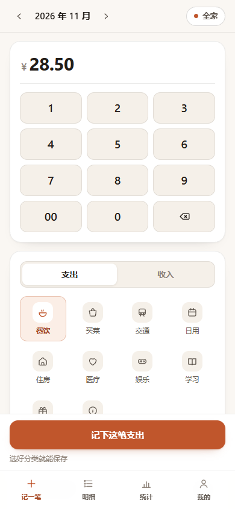
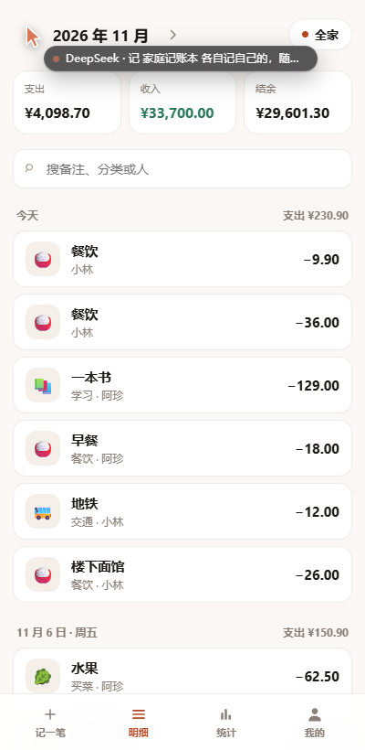
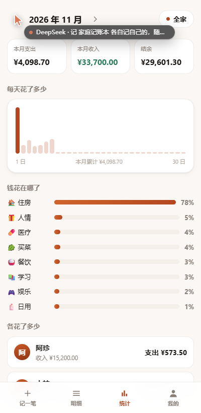

# 家庭记账本 · Family Ledger

一个给两个人（或一家人）用的网页记账本：**各自记自己的账，随时合起来看**。
打开就能按数字，三秒记完一笔；断网也能记，联网自动补传。

A tiny web ledger for couples and families: **each person records their own spending, and the two books merge into one view whenever you look.**
Open it, hit digits, done in about three seconds. Works offline; queued entries upload themselves later.

<p align="center">
  
  
  
</p>

---

## 这是什么 / What is this

仓库里有两个东西 / two things live in this repo:

| 目录 | 内容 | What |
| --- | --- | --- |
| `index.html` `assets/` | 个人主页（纯静态单页） | a personal homepage (plain static single page) |
| `ledger/` | 家庭记账本（Worker + D1 + PWA） | the family ledger app (Cloudflare Worker + D1 + PWA) |

个人主页：<https://flysusdjd.netlify.app>
记账本：<https://jizhang-flysusdjd.netlify.app>

> 为什么记账本的前端也在 Netlify：`*.workers.dev` 在中国大陆被干扰（TLS 握手直接失败），
> 所以静态文件放在国内能打开的 Netlify，API 仍然跑在 Cloudflare Worker 上，
> 由 `ledger/web/_redirects` 把 `/api/*` 转发过去 —— 同一个域名，cookie 照常工作。

Homepage: <https://flysusdjd.netlify.app> · Ledger: <https://jizhang-flysusdjd.netlify.app>

*Why is the frontend on Netlify too? `*.workers.dev` is interfered with in mainland China (TLS handshakes fail), so the static files live on Netlify while the API stays on a Cloudflare Worker; `ledger/web/_redirects` proxies `/api/*` there — same origin, so cookies keep working.*

---

## 功能 / Features

| 中文 | English |
| --- | --- |
| 账号密码注册登录，一个账号一个账本 | Sign up / sign in with username + password; each account owns one ledger |
| 邀请码把家人拉进来，**账本合在一起、各记各的** | Invite a family member with a 10-minute code; one shared ledger, separate authorship |
| 「全家 / 只看我」一键切换视图 | Toggle between *everyone* and *only mine* |
| 数字键盘直接按「分」输入，没有小数点 | Numeric keypad types cents directly — no decimal point to fiddle with |
| 13 个预置分类（10 支出 / 3 收入），可扩展 | 13 built-in categories (10 expense / 3 income), extensible |
| 按天分组的明细，每天自动小计 | Entries grouped by day with daily subtotals |
| 分类占比条形图 + 成员对比（谁花了多少） | Category bars plus a per-member breakdown |
| 删除是软删除，可以恢复 | Deletes are soft — restorable |
| 断网可记账，联网自动补传，**不会重复记两笔** | Offline capture with automatic, duplicate-free upload |
| 可安装成 PWA，手机上像原生 App | Installable PWA that feels native on a phone |
| 金额用整数「分」存储，不碰浮点误差 | Money stored as integer cents — no float drift |

---

## 设计上的几个决定 / Design decisions

**1. 密码不离开浏览器。**
注册和登录时，浏览器先做 60 万次 PBKDF2-SHA256，只把拉伸结果（`authHash`）发出去；Worker 再加一次服务端 `HMAC-SHA256(pepper, authHash)` 存库。
这么做的原因是 Cloudflare Workers 免费额度每次请求只有约 10ms CPU，实测本机 600k 次 PBKDF2 要 114ms，服务端做哈希必然超预算；放前端后服务端只花 0.1ms，而落库的仍然是加过 pepper 的、抗彩虹表的值。

*The password never leaves the browser. The client runs PBKDF2 (600k rounds) and posts only the stretched value; the worker adds one server-side HMAC with a pepper. A Worker on the free plan gets ~10ms CPU per request — hashing there is impossible, and stretching in the client keeps the stored value peppered anyway.*

**2.「合并」是视图，不是复制。**
每条账只存一份：`entries.household_id + created_by`。「只看我」只是 `WHERE created_by = 我`。如果真去复制两份账，迟早会分叉，谁也说不清哪个是对的。

*"Merging" is a view, not a copy. Each entry exists once; personal vs. family is just a different `WHERE`. Copying rows would inevitably diverge.*

**3. 离线靠 `client_uuid` 幂等。**
断网时记的账进本地队列，联网后按顺序补传；`UNIQUE(household_id, client_uuid)` 保证同一条重传一次也只有一笔。

*Offline entries queue locally and replay on reconnect; a unique `client_uuid` makes replay idempotent.*

**4. 金额是整数分。**
`amount_cents INTEGER`，前端只做显示时的格式化。`0.1 + 0.2` 的问题从源头就没有了。

---

## 技术栈 / Stack

- 前端：原生 HTML / CSS / ES modules，**零依赖、零构建**（没有 React，没有打包器）
- 后端：Cloudflare Worker（单文件 `worker/index.js`，手写路由）
- 数据库：Cloudflare D1（SQLite）
- 离线：Service Worker + localStorage 队列
- 本地开发：`node ledger/dev-server.mjs`，用 Node 24 内置的 `node:sqlite` 把 D1 的 API 垫出来，**跑的是和线上一模一样的那份 worker 代码**，不需要装 wrangler

*No framework, no bundler. The local dev server shims the D1 API onto `node:sqlite`, so the exact same worker file runs locally and in production.*

---

## 本地运行 / Run locally

需要 Node 22+（用到内置 `node:sqlite` 和原生 `fetch`）。

```bash
# 1. 启动本地服务（自动建库，端口 8787）
node ledger/dev-server.mjs

# 2. 打开 http://127.0.0.1:8787
```

想清空重来 / start over:

```bash
node ledger/dev-server.mjs --reset
```

造一份演示数据（两个成员、十几笔账）/ seed demo data:

```bash
node ledger/scripts/seed-demo.mjs
# 然后可用 demo / demo12345 或 ajane / demo12345 登录
```

跑接口自测 / run the API smoke tests:

```bash
node ledger/scripts/smoke.mjs
# ✅ 33 passed, 0 failed
```

---

## 部署到 Cloudflare / Deploy

> 全部在免费额度内：Pages/Workers 每日 10 万请求、D1 5GB 存储。
> 只有这一步需要你登录自己的 Cloudflare 账号。

```bash
cd ledger

# 1. 登录
npx wrangler login

# 2. 建 D1 数据库，把输出里的 database_id 填进 wrangler.toml
npx wrangler d1 create family-ledger

# 3. 建表
npx wrangler d1 execute family-ledger --file=worker/schema.sql --remote

# 4. 设置密码 pepper（自己随机生成一串，别用示例值）
npx wrangler secret put AUTH_PEPPER

# 5. 发布
npx wrangler deploy
```

发布后会得到 `https://family-ledger.<你的子域>.workers.dev`。
前端静态文件通过 `wrangler.toml` 里的 `[assets]` 一起发布，不需要单独部署。

### 本项目的实际部署 / How this instance is deployed

线上这一份是两段式部署的：

| 部分 | 位置 | 说明 |
| --- | --- | --- |
| 前端（HTML/CSS/JS/PWA） | Netlify `jizhang-flysusdjd.netlify.app` | `python ledger/scripts/pack-web.py` 打 zip，拖到 Netlify Drop |
| API + 数据库 | Cloudflare Worker + D1 | `wrangler deploy`，地址 `family-ledger.flysusdjd.workers.dev` |

两者之间靠 `ledger/web/_redirects` 里的一行代理连起来：

```
/api/*  https://family-ledger.flysusdjd.workers.dev/api/:splat  200
```

改前端的流程：改 `ledger/web/` → `python ledger/scripts/pack-web.py` → 把新 zip 拖到 Netlify 项目的 deploys 页。
改后端的流程：改 `ledger/worker/` → `cd ledger && npx wrangler deploy`。

*Two-part deploy: static files on Netlify, API on a Worker + D1, wired together by one proxy line in `_redirects`.*

> 备注 / note：因为本机沙箱不允许创建子进程，这里的 `wrangler` 是通过 esbuild stub 跑的（单文件 worker 不需要真打包）。
> 在你自己的电脑上直接用 `npx wrangler` 就行，不需要这些东西。

*Everything fits in the free tier. The only step that needs your own Cloudflare login is `wrangler login`.*

---

## 数据模型 / Data model

```sql
users(id, username, display_name, pwd_hash, created_at)
households(id, name, invite_code, invite_expires_at, created_at)
household_members(household_id, user_id, role, joined_at)
categories(id, household_id, name, emoji, direction, sort)
entries(id, household_id, created_by, amount_cents, direction,
        category_id, note, occurred_on, client_uuid, deleted_at, created_at)
entry_log(id, entry_id, user_id, action, payload, created_at)  -- 变更历史
sessions(token_hash, user_id, expires_at)                      -- 库里只存 token 的 SHA-256
```

---

## API

| 方法 | 路径 | 说明 |
| --- | --- | --- |
| POST | `/api/auth/register` | 注册（传 `authHash`，不传密码） |
| POST | `/api/auth/login` | 登录，返回 HttpOnly 会话 cookie |
| POST | `/api/auth/logout` | 退出 |
| GET | `/api/me` | 当前用户 + 账本成员 |
| GET | `/api/categories` | 分类列表 |
| GET/POST | `/api/entries` | 查账（`?month=2026-11&member=all\|me`）/ 记账 |
| PATCH/DELETE | `/api/entries/:id` | 改 / 软删除 |
| POST | `/api/entries/:id/restore` | 从回收站恢复 |
| GET | `/api/entries/deleted` | 回收站 |
| GET | `/api/stats` | 本月汇总、分类占比、成员对比 |
| POST | `/api/household/invite` | 生成 10 分钟邀请码 |
| POST | `/api/household/join` | 用邀请码加入 |
| GET | `/api/health` | 健康检查 |

---

## 目录结构 / Layout

```
.
├── index.html              # 个人主页 / personal homepage
├── assets/                 # 主页样式与脚本
├── ledger/
│   ├── worker/
│   │   ├── index.js        # 唯一的后端源码 / the whole backend
│   │   └── schema.sql      # D1 建表语句
│   ├── web/
│   │   ├── index.html      # 应用外壳 / app shell
│   │   ├── styles.css
│   │   ├── app.js          # 所有前端逻辑 / all front-end logic
│   │   ├── sw.js           # Service Worker
│   │   └── manifest.webmanifest
│   ├── dev-server.mjs      # 本地服务器（node:sqlite 冒充 D1）
│   ├── scripts/
│   │   ├── smoke.mjs       # 33 项接口自测
│   │   ├── seed-demo.mjs   # 演示数据
│   │   └── make-icons.py   # 生成 PWA 图标
│   └── wrangler.toml       # 部署配置 / deploy config
└── docs/
```

---

## 路线图 / Roadmap

- [x] 账号密码登录、账本、分类、明细、统计
- [x] 邀请码 + 家庭共享（各记各的、合并查看）
- [x] 离线记账与幂等补传、PWA 可安装
- [ ] 记一笔页面支持自定义分类
- [ ] 月度预算与超支提醒
- [ ] 导出台账为 CSV
- [ ] 定期记账（房租等固定支出自动入账）

---

## 许可 / License

[MIT](LICENSE) © 2026 flysusdjd

随便用、随便改，保留版权声明即可。
*Use it, fork it, change it — just keep the copyright notice.*
